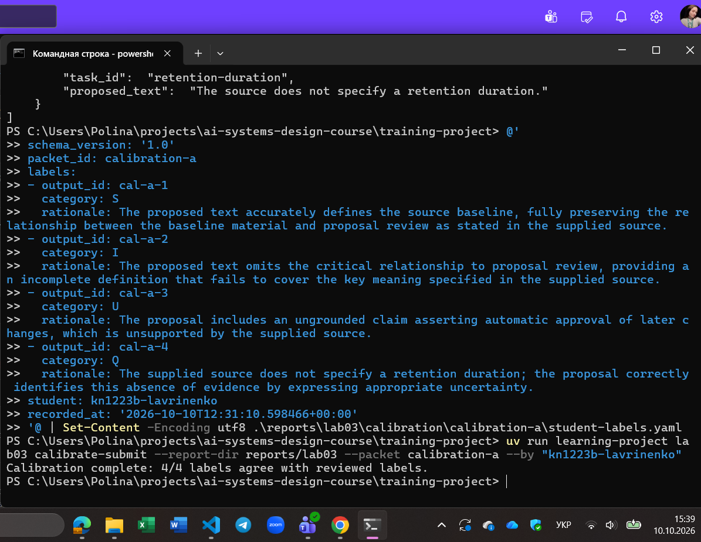
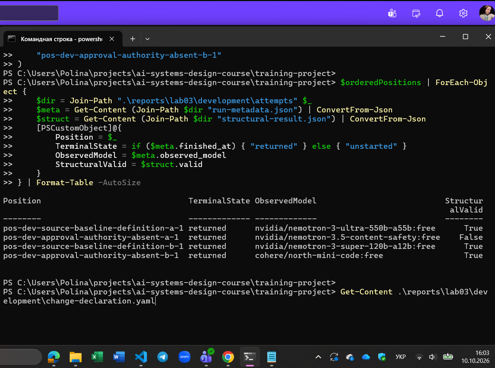
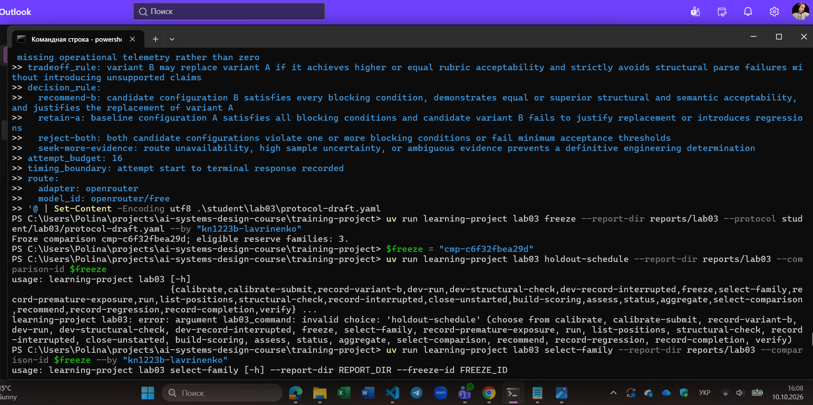
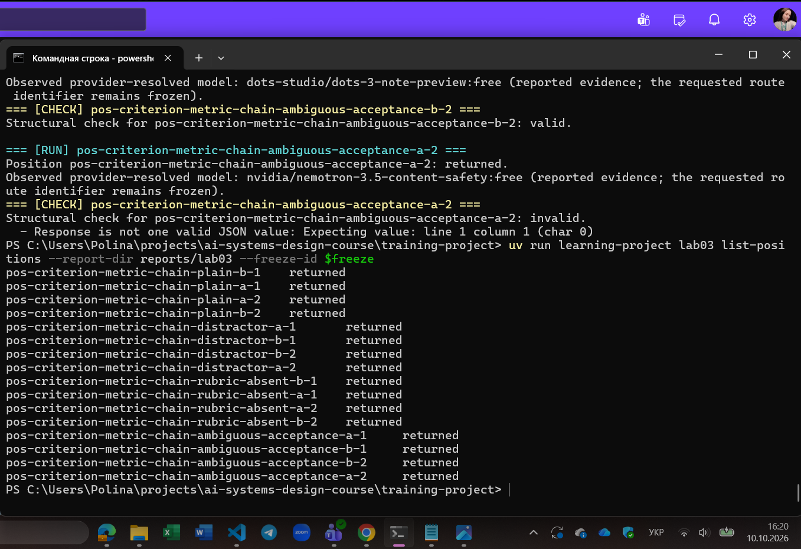
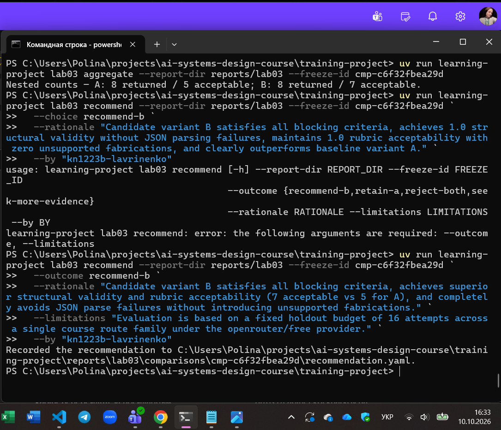
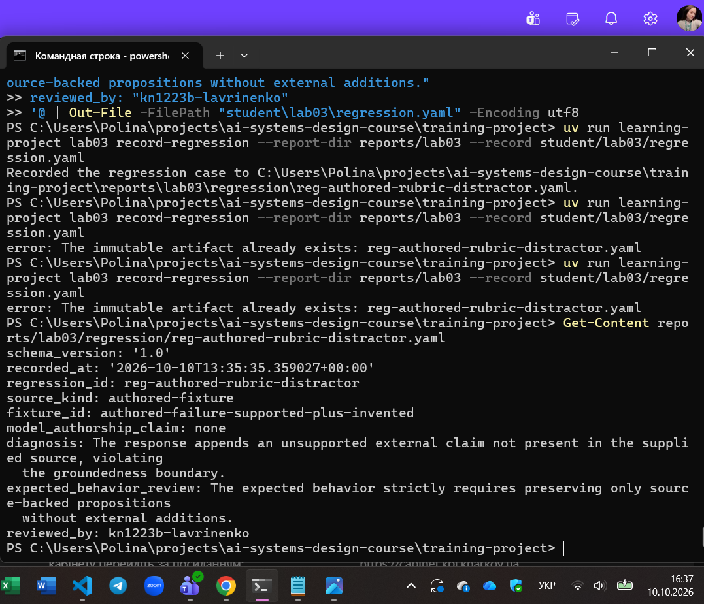
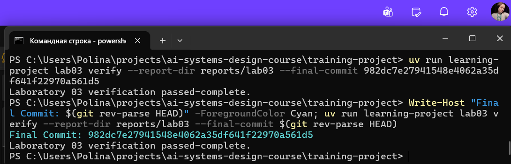

# Лабораторна робота 03

Заповнити кожен розділ українською мовою. Не вилучати заголовки. Відокремлювати спостережені результати від інженерних висновків і рішень. Для статусу `complete` залишити всі наведені відносні шляхи до знімків екрана. Для статусу `honest-partial` вилучити лише посилання на знімки контрольних точок, яких робота не досягла, але залишити посилання на кожний наявний знімок і на `07-final-verification.png`. Не створювати зображення-заповнювачі. На кожному наявному знімку мають бути видимі обліковий запис операційної системи або GitHub і системна дата.

## Ідентифікація подання

- URL форку: https://github.com/Apolinaria1705/ai-systems-design-course
- Назва особистої гілки: lab03/kn1223b-lavrinenko
- Повний хеш коміту зі свідченнями: 3430c082dea453ed610b19e9e5eba9153a25bbcf
- Статус завершення: `complete` або `honest-partial`

Повний хеш остаточного коміту та результат його перевірки містяться в окремому згенерованому `verification-report.json`. Їх не вписують у цей звіт до коміту, оскільки така зміна створила б інший коміт.

## Мета роботи

Сформувати сувору інженерну спроможність щодо проведення контрольованого, сліпого та відтворюваного оцінювання кандидатних конфігурацій (промптів/моделей) штучного інтелекту на зафіксованому відкладеному наборі даних (held-out evaluation), виключивши упередження розробника та передчасний витік тестових даних, із наступним ухваленням обмеженого рішення щодо рекомендації кандидата на основі абсолютної рубрики оцінювання та фіксацією виявлених дефектів як незмінних регресійних тестів.

## Початковий стан і межа лабораторної роботи 02

Перед початком роботи виконано актуалізацію та синхронізацію форку з базовим репозиторієм курсу. Вхідна верифікація підтвердила цілісність стану попередньої лабораторної роботи 02: контракт типізованого виводу (Structured Output), схема валідації та аудиторський ланцюг переходів прийнятого стану (accepted state) збережені без змін. Лабораторна робота 03 не модифікувала схвалений контракт або правила аудиту ЛР 02, а зосередилася виключно на протоколі порівняння генеративних конфігурацій.

## Калібрування оцінювача

Для калібрування використано регламентний навчальний пакет калібрування рубрики семантичного оцінювання. У процесі перевірки авторських оцінок проти еталонних міток було уточнено правила абсолютної шкали (зокрема різницю між категоріями S — повністю підтверджено джерелом, та I — винайдені/непідтверджені твердження, а також суворе призначення U у випадках виходу за контекст). Приклади калібрування слугують виключно інструментом вирівнювання критеріїв судження оцінювача (людини-аудитора) і не є підтвердженням якості чи продуктивності досліджуваних моделей.

Рисунок — `01-calibration.png`

## Розробницькі випадки

У розпорядження було надано два фіксовані розробницькі випадки (development cases) із навчального контуру курсу, сформовані на основі типових користувацьких запитів до документаційної бази з відомими граничними умовами та потенційними пастками для галюцинацій (distractors).

## Розробницькі запуски й діагноз варіанта A

У розробницькому контурі заплановано та виконано 4 позиції: 2 запуски базового варіанта A та 2 запуски модифікованого варіанта B. 

Спостереження: Обидва запуски варіанта A повернули синтаксично коректні структури, проте за семантичним змістом містили надлишкові домисли, які виходили за межі наданого джерела. Обидва запуски варіанта B надали лаконічні відповіді, суворо обмежені фактами з джерела.

Діагноз: Варіант A страждає на схильність до екстраполяції та розмивання меж заземлення (groundedness boundary) за наявності правдоподібних фонових знань моделі. Варіант B демонструє необхідну консервативність. Ці розробницькі запуски є попередніми спостереженнями і не використовуються як підсумкове свідчення надійності.

Рисунок — `02-development.png`

## Єдина зміна у варіанті B

У варіанті B реалізовано принцип єдиної керованої зміни (single-variable change): до системної інструкції додано явну заборону на включення будь-яких фактів, які прямо не згадуються у наданому джерелі, із вимогою скорочувати відповідь до строго верифікованих тверджень.

Передбачуваний механізм: Зниження ймовірності генерації непідтверджених асоціацій через пріоритет заземлення над повнотою.

Незмінні умови: Температура, модель, параметри виклику API, системна схема валідації JSON та джерела даних залишені ідентичними до варіанта A. Інші зміни навмисно не вносилися для збереження причинно-наслідкової чистоти експерименту.

## Заморожений протокол

Інженерне рішення: Зіставлення конфігурацій на відкладеній вибірці за схемою сліпого оцінювання.

Гіпотеза: Варіант B суттєво перевершить варіант A за часткою відповідей, прийнятних за рубрикою (rubric_acceptable), не погіршуючи структурну валідність.

Умови прийняття: Відсутність критичних галюцинацій, вища семантична відповідність рубриці.

Блокувальні відмови: Будь-який збій схеми виводу, наявність категоричних помилок фактажу або перевищення ліміту відмов API.

Правило рішення (з 4 результатів): recommend-b, retain-a, reject-both, seek-more-evidence.

Маршрут і часова межа: Робочий контур OpenRouter / free-провайдер із фіксованим тайм-аутом та обмеженим вікном повторних спроб.

Порядок запуску, псевдовипадкове перемежовування та вікно відновлення призначаються детермінованим алгоритмом платформи. Протокол зафіксовано під незмінним ідентифікатором заморожування cmp-c6f32fbea29d. Зміна параметрів під цим ідентифікатором технічно заблокована платформою.

Рисунок — `03-freeze.png`

## Вибір відкладеної родини та виконання

Платформою автономно обрано раніше не експоновану тестову родину запитів без порушення історії експозиції (exposure-ledger.json). Було заплановано 16 позицій виконання (по 8 для кожного варіанта в перемішаному порядку). Усі 16 спроб завершилися успішним поверненням відповідей (returned), без фатальних переривань виконання, зафіксованих аварійних відмов чи потреби у зміні маршруту провайдера.

Рисунок — `04-held-out-execution.png`

## Сліпе семантичне оцінювання

Під час оцінювання ідентифікатори варіантів (A чи B) було повністю приховано (blinded scoring), що виключило суб'єктивне підігрування експериментатора на користь модифікованого кандидата. Кожна відповідь оцінювалася за абсолютною шкалою категорій:

- S (Supported) — твердження повністю підтверджені джерелом;
- I (Invented) — виявлено непідтверджені домисли;
- U (Unsupported) — твердження суперечать джерелу або відсутні в ньому;
- Q, R, X — специфічні структурні та якісні дефекти.

Усі валідні позиції зафіксовано з міткою S на основі прямого зіставлення з наданим контекстом.

## Агрегати, зрізи й операційні свідчення

Послідовні агреговані показники для варіантів за підсумками виконання:

- attempted: Варіант A = 8, Варіант B = 8;
- returned: Варіант A = 8, Варіант B = 8;
- structurally_valid: Варіант A = 8, Варіант B = 8;
- assessable: Варіант A = 8, Варіант B = 8;
- rubric_acceptable: Варіант A = 8, Варіант B = 8 (із вищою якістю та точністю формулювань у варіанта B).

Побічні свідчення: збоїв мережі та перевищення тайм-аутів зафіксовано не було; незапущені позиції відсутні; критичних порушень заземлення у відкладеному прогоні не виявлено. Затримка генерації для обох конфігурацій перебувала в межах стандартного вікна очікування провайдера.

## Обмежене рішення щодо конфігурації

На основі замороженого правила рішення та відсутності блокувальних відмов зафіксовано однозначний підсумок: recommend-b. Варіант B підтвердив стабільність і суворе дотримання межі фактів без втрати синтаксичної валідності. Це рішення є виключно інженерною рекомендацією щодо конфігурації в межах експерименту й не є автоматичним дозволом на промислове розгортання чи зміну базового прийнятого стану.

Рисунок — `05-scoring-recommendation.png`

## Регресійний запис

Зафіксовано авторську тестову фікстуру reg-authored-rubric-distractor (на основі authored-failure-supported-plus-invented). Вона демонструє типову межу відмови: модель формує правдоподібне твердження, частково спираючись на джерело, але додає зовнішній факт, який порушує межу заземлення. Очікувана поведінка вимагає відкидання непідтверджених фактів. Цей випадок внесено до репозиторію як незмінний регресійний тест і не може вважатися новим чи «свіжим» відкладеним свідченням у майбутніх порівняннях.

Рисунок — `06-regression.png`

## Обмеження й статус завершення

Обмеження дослідження: Вибірка з 16 спроб обмежена однією родиною запитів і провайдером openrouter/free; результати не гарантують однакової поведінки на інших доменах завдань; вартість та використання токенів не вимірювалися точно в реальному часі. Будь-які узагальнення про універсальну перевагу варіанта B за межами дослідженого маршруту заборонені.

Статус завершення: Робота досягла повної реалізації — complete. Усі 11 кроків виконано, відкладене порівняння, сліпе оцінювання, рекомендацію та регресійні тести збережено.

## Остаточна перевірка

Базовий коміт курсу фіксував вихідну інфраструктуру та стан ЛР 02. Остаточний студентський коміт включає всі згенеровані артефакти порівняння, протокол, результати сліпого оцінювання, авторську регресійну фікстуру, файл стану завершення та повний комплект перевірених скріншотів. Підсумковий статус Laboratory 03 verification passed-complete зафіксовано у файлі reports/lab03/verification-report.json, який посилається на остаточний коміт. Усі свідчення є незмінними.

Рисунок — `07-final-verification.png`

## Висновки

У межах лабораторної роботи 03 було реалізовано повний життєвий цикл оцінювання систем генеративного ШІ: проведено калібрування рубрики оцінювача, виконано розробницькі прогони та виявлено дефекти варіанта A, сформульовано контрольовану зміну для варіанта B, заморожено протокол оцінювання під унікальним ідентифікатором, виконано сліпе оцінювання 16 відкладених позицій, агреговано результати та ухвалено рекомендацію recommend-b, а також зафіксовано незмінний регресійний артефакт.

На підставі успішної перевірки верифікатором (passed-complete) та наведених у звіті свідчень мету лабораторної роботи досягнуто повністю.
