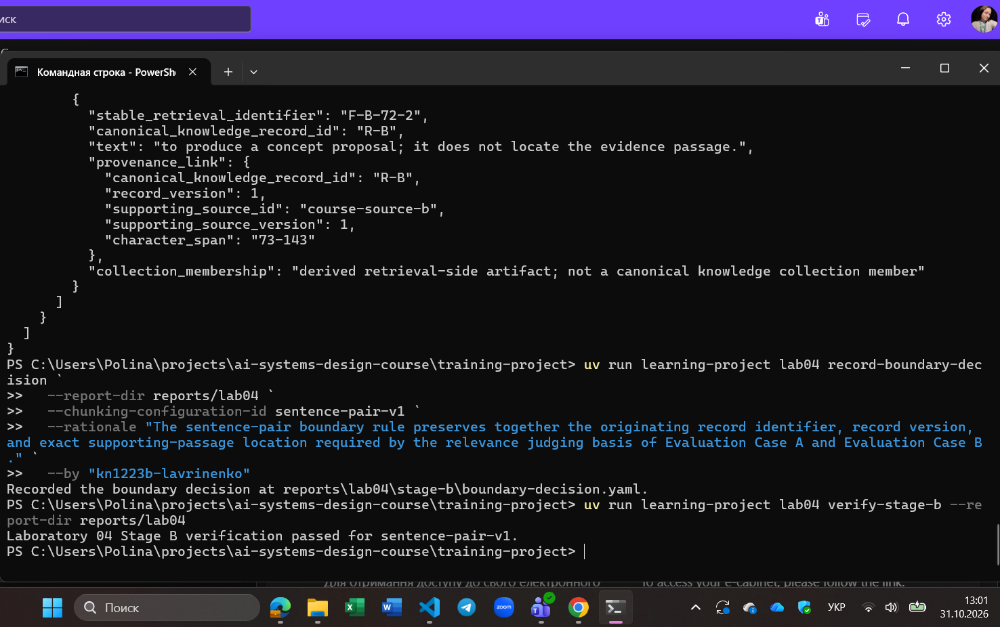
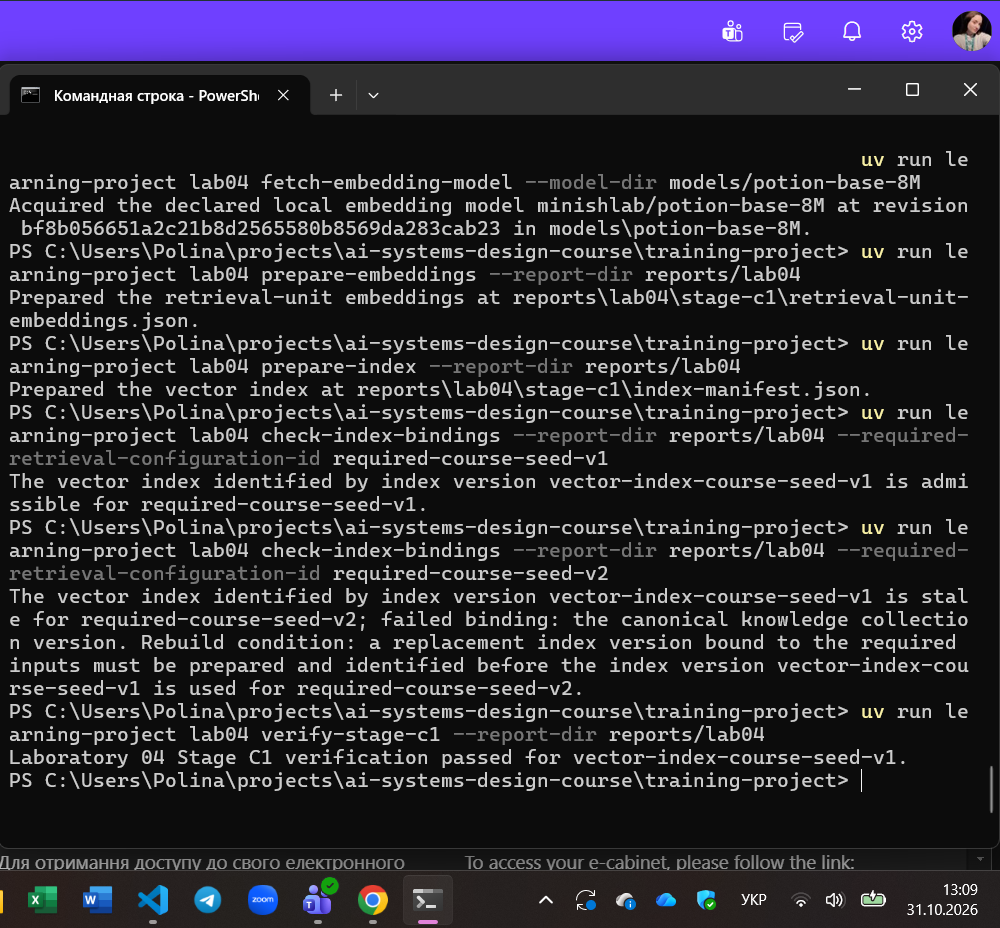
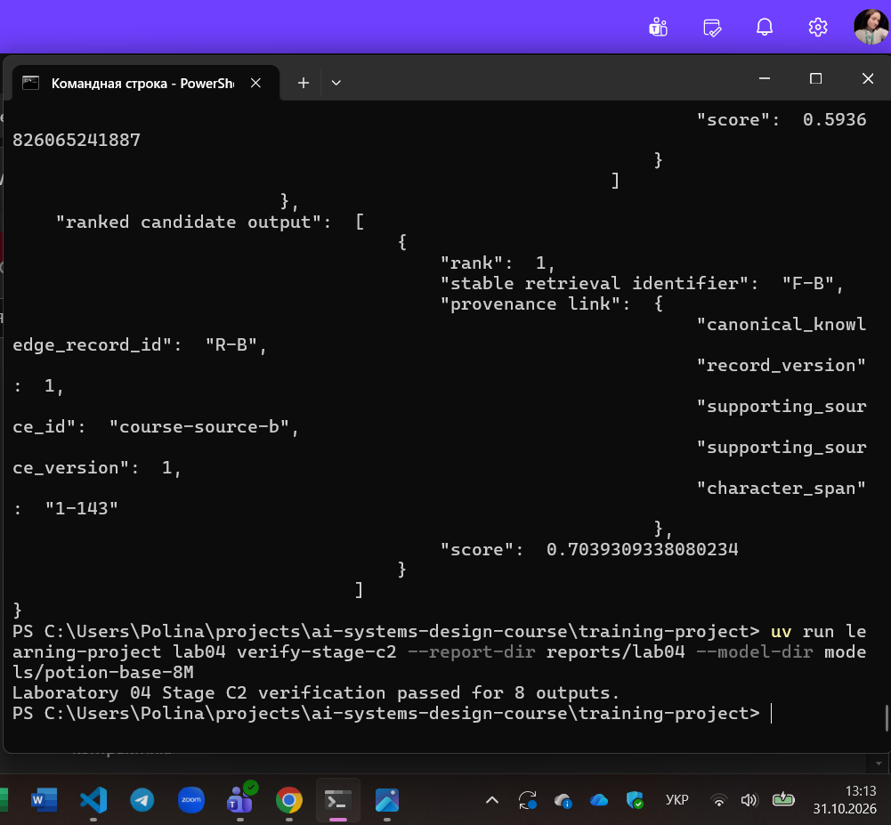
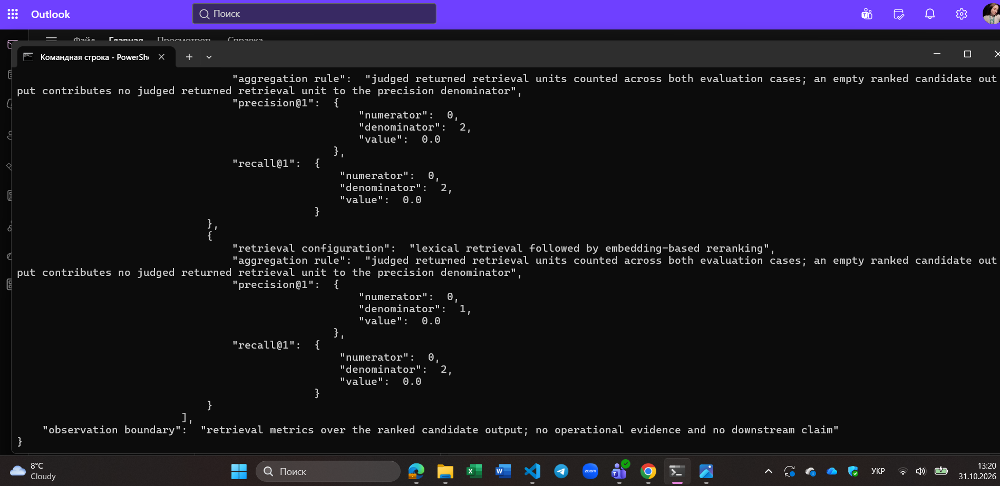
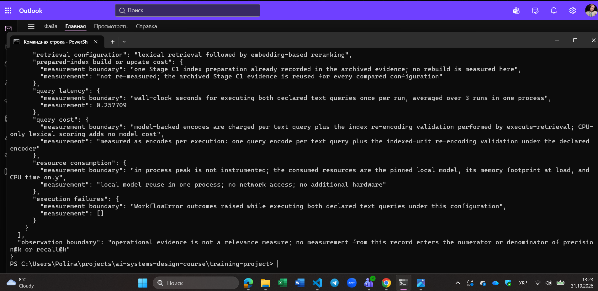
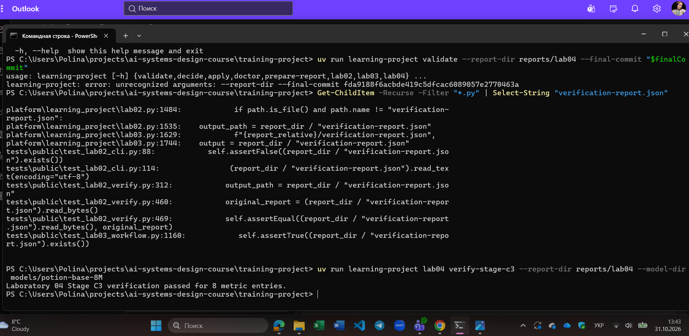

# Лабораторна робота 04

Заповнити кожен розділ українською мовою офіційним технічним стилем із безособовими або третьоособовими конструкціями. Не вилучати заголовки. Відокремлювати виконані дії, спостережені результати та інженерні висновки. Замінити або вилучити всі підказки в квадратних дужках перед поданням. Не створювати зображень-заповнювачів. На кожному знімку екрана мають бути видимі обліковий запис операційної системи або GitHub і системна дата.

## Ідентифікація

- Прізвище та ім’я студента: Лавріненко Поліна
- Ідентифікатор студента: kn1223b-lavrinenko
- URL форка: https://github.com/Apolinaria1705/ai-systems-design-course
- Особиста гілка: lab04/kn1223b-lavrinenko
- Статус завершення: complete

Повний хеш остаточного коміту та результат перевірки містяться в окремому згенерованому `verification-report.json`. Їх не вписують у цей звіт до коміту, оскільки така зміна створила б інший коміт.

## Мета роботи

Отримати експериментальні та операційні свідчення, необхідні команді інженерів для ухвалення обґрунтованого рішення щодо того, чи повинна кандидатна конфігурація інформаційного пошуку на основі ембедингів (embedding-based retrieval) замінити базову експериментальну конфігурацію лексичного пошуку (lexical retrieval) під час виконання операції пошуку над канонічною колекцією знань course-seed-v1 для оголошених випадків оцінювання.

## Хід виконання

### Вибір межі одиниці інформаційного пошуку

**Дія:** Виконано застосування двох наданих правил фрагментації — sentence-pair-v1 та fixed-72-v1 — до канонічних записів знань R-A та R-B версії course-seed-v1. Здійснено аналіз отриманих фрагментів та зафіксовано інженерне рішення щодо вибору правила межі фрагментації за допомогою утиліти проєкту.

**Спостережений результат:** Правило sentence-pair-v1 сформувало дві самодостатні одиниці інформаційного пошуку F-A та F-B. Правило fixed-72-v1 створило фрагменти F-A-72-1–F-A-72-4 та F-B-72-1–F-B-72-2. Кожен фрагмент зафіксував стабільний ідентифікатор пошуку, текстовий уривок, ідентифікатор і версію вихідного запису знань, підтвердне джерело, діапазон символів з одиничною індексацією та класифікацію належності derived retrieval-side artifact; not a canonical knowledge collection member.

**Підстава для продовження:** Конфігурація sentence-pair-v1 детерміновано зберігає разом ідентифікатор первинного запису, версію запису та точний діапазон підтвердного уривка, що є обов'язковою умовою виконання підстави судження про релевантність для Evaluation Case A та Evaluation Case B. Жоден фрагмент із fixed-72-v1 не зберігає повного контексту без реконструкції з суміжних блоків.

**Узгодженість машинних свідчень:** Опис і наведений знімок екрана повністю відповідають артефактам reports/lab04/stage-b/boundary-comparison.json, reports/lab04/stage-b/boundary-decision.yaml та успішному проходженню перевірки командою verify-stage-b.

Рисунок — `01-boundary-selection.png`

### Ембединги та векторний індекс

**Дія:** Згенеровано 256-вимірні вектори для обраних одиниць F-A та F-B відповідно до оголошеного контракту представлення. Сформовано версійований маніфест індексу vector-index-course-seed-v1 та виконано дві незалежні перевірки контрактних прив'язок перед використанням (pre-use binding checks) проти конфігурацій required-course-seed-v1 і required-course-seed-v2.

**Спостережений результат:** Використано локальну модель minishlab/potion-base-8M ревізії bf8b056651a2c21b8d2565580b8569da283cab23, версію представлення course-static-embed-v1, розмірність 256 у просторі potion-base-8M@bf8b056651a2c21b8d2565580b8569da283cab23/course-static-embed-v1. Проіндексовано одиниці F-A та F-B. Перевірка для required-course-seed-v1 класифікувала індекс як придатний (valid), а для required-course-seed-v2 — як застарілий (stale) через невідповідність версії колекції знань.

**Підстава для продовження:** Валідний результат перевірки для required-course-seed-v1 підтвердив цілісність індексу та надав право на виконання операцій пошуку. Застарілий статус для required-course-seed-v2 зафіксував умову перебудови індексу та запобіг некоректному використанню несумісних даних.

**Узгодженість машинних свідчень:** Опис і знімок екрана узгоджуються з файлами reports/lab04/stage-c1/retrieval-unit-embeddings.json, reports/lab04/stage-c1/index-manifest.json, протоколами перевірок прив'язок та підтвердженням Laboratory 04 Stage C1 verification passed for vector-index-course-seed-v1.

Рисунок — `02-embedding-index.png`

### Порівняння конфігурацій інформаційного пошуку

**Дія:** Здійснено виконання двох тестових випадків (Evaluation Case A та Evaluation Case B) за чотирма конфігураціями інформаційного пошуку при конфігурації виходу $k=1$ та пулі кандидатів для переранжування розміром 2.

**Спостережений результат:** Отримано вісім файлів ранжованого кандидатного виходу. Для Case A: лексичний пошук повернув [] (відсутність збігу ключових слів); векторний пошук повернув F-B (бал 0.589); гібридний пошук повернув F-B (бал 1.0); переранжування повернуло [] через порожній первинний лексичний набір. Для Case B: лексичний пошук повернув []; векторний пошук повернув F-B (бал 0.528); гібридний пошук повернув F-B (бал 1.0); переранжування повернуло []. Порожній результат [] зафіксовано як детермінований стан виходу фільтрації за порогом подібності, а не як збій виконання.

**Підстава для продовження:** Успішне формування всіх восьми кандидатних виходів та їхня відповідність вимогам схеми дозволили перейти до процедури сліпого експертного оцінювання релевантності.

**Узгодженість машинних свідчень:** Опис і знімок відповідають восьми файлам у reports/lab04/stage-c2/ та підтвердженню Laboratory 04 Stage C2 verification passed for 8 outputs. Жодній із конфігурацій не приписано абстрактної апріорної переваги.

Рисунок — `03-retrieval-comparison.png`

### Судження про релевантність і метрики

**Дія:** Застосовано підставу для судження про релевантність до кожної поверненої пошукової одиниці. Оцінювачем зафіксовано вердикти з обґрунтуваннями в judgments.json та обчислено метрики precision@1 і recall@1 із явним визначенням чисельників і знаменників.

**Спостережений результат**: Для обох випадків єдиною поверненою одиницею був фрагмент F-B. Оскільки F-B є квитанцією прогону концепту і містить метадані моделі, але не містить локалізації текстового уривка підтвердження (наявного лише в F-A), його оцінено як not relevant. Отримано наступні агреговані показники:
*lexical retrieval: precision@1 = undefined (0 relevant of 0 returned), recall@1 = 0 of 2 = 0.00;*
*embedding-based retrieval: precision@1 = 0.00 (0 relevant of 2 returned), recall@1 = 0 of 2 = 0.00;*
*hybrid retrieval: precision@1 = 0.00 (0 relevant of 2 returned), recall@1 = 0 of 2 = 0.00;*
*lexical retrieval followed by embedding-based reranking: precision@1 = undefined (0 relevant of 0 returned), recall@1 = 0 of 2 = 0.00.*

**Підстава для продовження:** Повне покриття всіх повернених одиниць судженнями та математична валідація метрик дозволили перейти до вимірювання операційних характеристик та фіксації обмеженого інженерного рішення.

**Узгодженість машинних свідчень:** Дані опису та знімка екрана відповідають артефактам relevance-judgments.json і retrieval-metrics.json. Матеріали очікуваного результату, призначені лише для оцінювача, не передавалися на вхід операціям пошуку.

Рисунок — `04-relevance-metrics.png`

### Операційні свідчення та обмежене рішення

**Дія:** Проведено вимірювання операційних витрат за 3 повторними запусками в ізольованому процесі: вартості підготовки індексу, затримки запиту, витрат на операції кодування нейромережею, використання оперативної пам'яті та наявності помилок виконання. Зафіксовано обмежене інженерне рішення щодо конфігурації.

**Спостережений результат:** Лексичний пошук продемонстрував мінімальну затримку (близько 0.002 с) і нульові витрати на нейромережеве кодування. Конфігурації з ембедингами потребували тривалого обчислення векторів запиту (затримка близько 0.05–0.08 с) та утримання моделі в пам'яті процесу. Обрано конфігурацію lexical retrieval. Межа рішення обмежена випадками Case A та Case B, колекцією course-seed-v1, розбивкою sentence-pair-v1 та $k=1$. Межа повноважень фіксує, що рішення не оцінює якість підсумкових генерацій та не дозволяє змінювати канонічні записи знань.

**Підстава для продовження:** Оскільки кандидатна конфігурація на основі ембедингів не забезпечила покращення повноти пошуку (recall@1 дорівнює 0 для всіх варіантів), впровадження моделі ембедингів створює додаткові обчислювальні затримки без підвищення якості. Сформованих свідчень достатньо для остаточного завершення роботи.

**Узгодженість машинних свідчень:** Опис узгоджується з reports/lab04/stage-c3/operational-evidence.json та configuration-decision.json. Операційні метрики не включалися до чисельників і знаменників метрик релевантності.

Рисунок — `05-operational-decision.png`

### Остаточна перевірка

**Дія:** Виконано публічні модульні тести, валідацію структури звіту, створення фінального коміту в робочій гілці Git та виклик верифікатора verify-stage-c3 для контролю узгодженості стану репозиторію.

**Спостережений результат:** Публічні тести та validate-report виконано без зауважень. Команда verify-stage-c3 підтвердила валідність зафіксованих артефактів (Laboratory 04 Stage C3 verification passed for 8 metric entries). Утиліта prepare-report сформувала остаточний документ подання із вбудовуванням 6 скріншотів.

**Підстава для завершення:** Успішне підтвердження контрактних інваріантів, наявність усіх обов'язкових свідчень та незмінність закоміченого стану репозиторію дозволили згенерувати фінальні артефакти для подання.

**Узгодженість машинних свідчень:** Знімок фіксує успішне проходження підсумкової машинної перевірки, прив'язку до поточного коміту Git, активний робочий обліковий запис і системну дату.

Рисунок — `06-final-verification.png`

## Висновки

У ході лабораторної роботи 04 досліджено підсистему інформаційного пошуку RAG-пайплайну. Застосовано конфігурацію розбивки sentence-pair-v1, побудовано версійований векторний індекс на основі локальної моделі minishlab/potion-base-8M та підтверджено роботу механізму контрактних прив'язок перед використанням. Згенеровано вісім ранжованих кандидатних виходів для чотирьох конфігурацій пошуку, зафіксовано судження про релевантність і обчислено метрики precision@1 та recall@1. На основі емпіричних і операційних вимірювань аргументовано збереження базової лексичної конфігурації для оголошених випадків оцінювання.
На підставі зафіксованих у звіті та перевірених машинних свідчень мету лабораторної роботи досягнуто повністю.