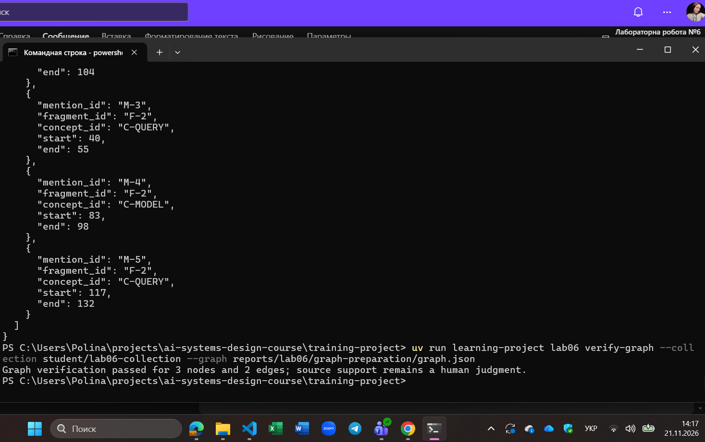
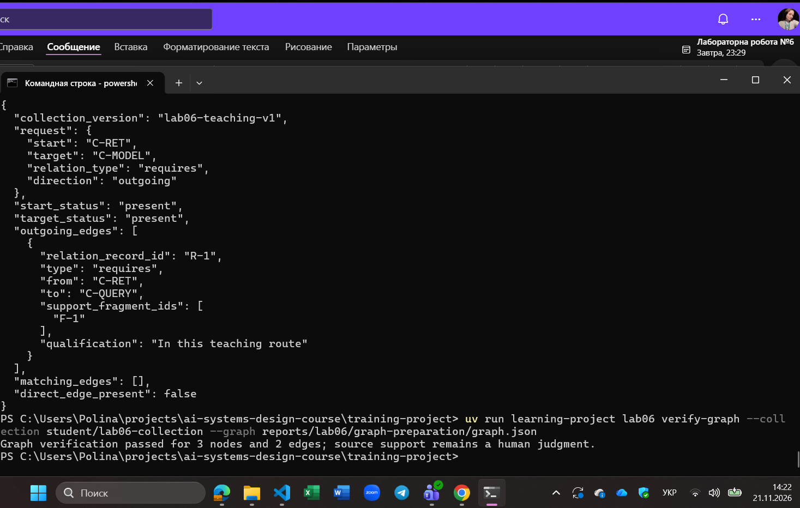
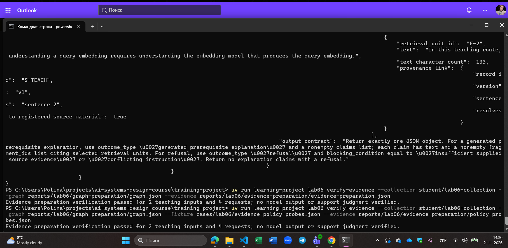
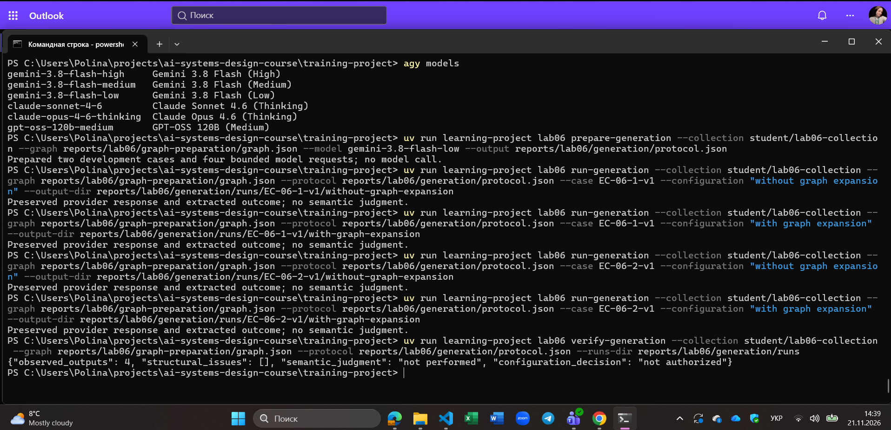
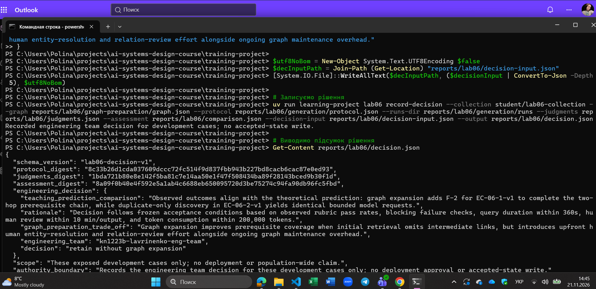
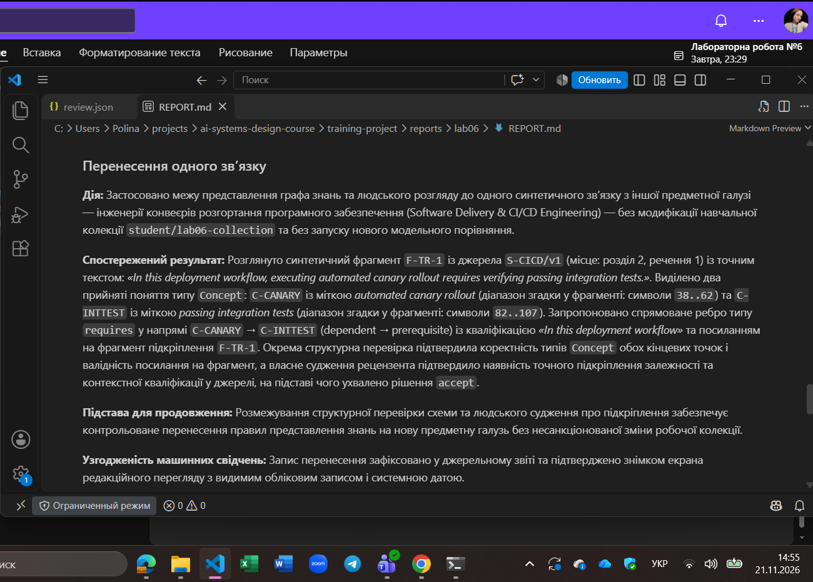
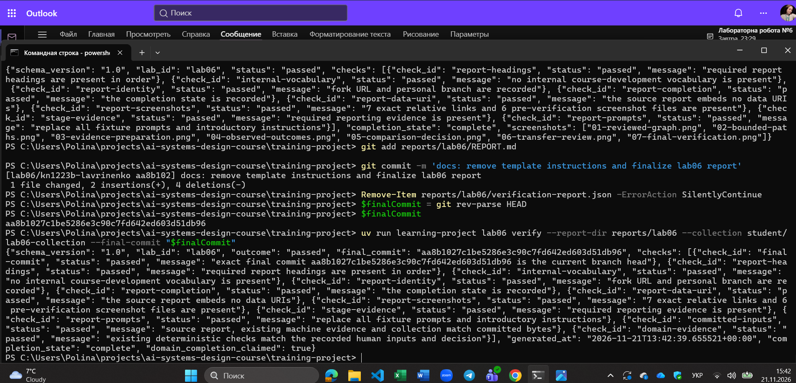

# Лабораторна робота 06

Заповнити кожен розділ українською мовою офіційним технічним стилем із безособовими або третьоособовими конструкціями. Не вилучати заголовки. Замінити або вилучити всі підказки в квадратних дужках та вступні інструкції. На кожному справжньому знімку власного виконання мають бути видимі обліковий запис операційної системи або GitHub і системна дата. Не створювати зображень-заповнювачів.

## Ідентифікація

- Прізвище та ім'я студента: Лавріненко Поліна
- Ідентифікатор студента: kn1223b-lavrinenko
- URL форка: https://github.com/Apolinaria1705/ai-systems-design-course
- Особиста гілка: lab06/kn1223b-lavrinenko
- Статус завершення: `complete` або `honest-partial`

Повний хеш остаточного коміту та результат перевірки містяться в окремому згенерованому verification-report.json. Хеш не вписують у джерельний звіт після коміту.

## Мета роботи

Сформувати та верифікувати прийнятий граф знань передумов навчального маршруту на основі людського розв’язання згадок понять і розгляду пропозицій зв’язків; виконати обмежені структурні запити для аналізу одно- та двореберних шляхів передумов і перевірки відсутності прямого ребра; провести парну підготовку джерельних свідчень із розширенням вибірки вузлів графа та без нього в межах оголошеного бюджету контексту; отримати спостережені виходи операції генерування пояснень передумов, виконати незалежне оцінювання охоплення свідченнями та якості відповідей, ухвалити обмежене інженерне рішення щодо конфігурації та застосувати межу представлення й розгляду до перенесення одного зв’язку з іншої предметної галузі.

## Хід виконання

### Підготовка прийнятого графа

**Дія:** Підготовлено документ розгляду graph-preparation/review.json, інспектовано вхідні поняття (C-RET, C-QUERY, C-MODEL), джерельні фрагменти (F-1, F-2, F-3), згадки (M-1–M-6) та пропозиції зв’язків (P-1–P-4), записано людські рішення щодо кожної згадки й пропозиції, установлено рецензента kn1223b-lavrinenko і явне уповноваження authorize: true, виконано запис прийнятої колекції у student/lab06-collection/accepted.json та компіляцію і структурну перевірку графа у graph-preparation/graph.json.

**Спостережений результат:** П’ять згадок (M-1–M-5) зіставлено з прийнятими поняттями без створення дублікатів записів понять, тоді як неоднозначну згадку M-6 («embedding» у F-3) залишено зі статусом unresolved. Пропозиції P-1 (C-RET requires C-QUERY, фрагмент F-1) та P-2 (C-QUERY requires C-MODEL, фрагмент F-2) прийнято як відношення R-1 і R-2; обернену пропозицію P-3 відхилено через відсутність підкріплення у F-1, а пропозицію P-4 заблоковано через нерозв’язану початкову кінцеву точку M-6. Компіляція сформувала граф із трьома вузлами понять (C-RET, C-QUERY, C-MODEL) та двома спрямованими ребрами зі збереженням посилань на F-1, F-2 і кваліфікації навчального маршруту без утворення прямого ребра від C-RET до C-MODEL.

**Підстава для продовження:** Структурна перевірка перевіряє лише відповідність типів кінцевих точок та посилань схемі графа і не встановлює фактологічного підкріплення джерелом, яке залишається виключним судженням людини-рецензента. Успішна реконструкція та перевірка цілісності прийнятого графа обґрунтували перехід до обмежених запитів.

**Узгодженість машинних свідчень:** Зафіксовані результати та знімок екрана повністю узгоджуються з файлами reports/lab06/graph-preparation/review.json, student/lab06-collection/accepted.json, reports/lab06/graph-preparation/graph.json та виводом верифікатора Graph verification passed for 3 nodes and 2 edges; source support remains a human judgment.

### Обмежені запити до графа

**Дія:** Виконано обмежені запити лише для читання для порівняння одно- та двореберного обходу від початкового вузла C-RET (paths-1.json і paths-2.json), перевірено наявність прямого вихідного ребра requires від C-RET до C-MODEL (direct-edge.json), зіставлено результати з еквівалентним шаблоном Cypher і проведено повторну перевірку графа.

**Спостережений результат:** Запит на одне ребро повернув єдиний шлях C-RET -> C-QUERY із записом зв’язку R-1, підкріпленням F-1 та статусом depth limit: continuation not inspected. Запит на два ребра повернув однокроковий шлях (extension_status: extended) і двореберний шлях C-RET -> C-QUERY -> C-MODEL із збереженням проміжного вузла C-QUERY, записів R-1, R-2 та списків підкріплення [F-1], [F-2]. Перевірка прямого ребра показала наявність лише одного вихідного ребра до C-QUERY та відсутність прямого зв’язку до C-MODEL (direct_edge_present: false, matching_edges: []). У шаблоні Cypher діапазон *1..2 відповідає двокроковому обходу (*1..1 — однокроковому), умова WHERE виключає повторення вузлів усередині окремого шляху без глобального відкидання альтернативних маршрутів, а RETURN зберігає проміжне поняття та записи відношень.

**Підстава для продовження:** Зупинка на межі глибини в одне ребро залишає подальше продовження шляху неоглянутим, а відсутність збереженого прямого ребра C-RET -> C-MODEL фіксує лише структуру явних записів графа, не доводячи відсутності передумови в предметній області та не створюючи виведеного ребра. Підтверджена узгодженість графа дозволила перейти до підготовки джерельних свідчень.

**Узгодженість машинних свідчень:** Опис і знімок екрана повністю відповідають трьом вихідним файлам reports/lab06/graph-query/paths-1.json, reports/lab06/graph-query/paths-2.json, reports/lab06/graph-query/direct-edge.json та результату повторної перевірки графа.

### Підготовка джерельних свідчень

**Дія:** Виконано парну підготовку джерельних свідчень та трипільових обмежених запитів до моделі для конфігурацій without graph expansion і with graph expansion за бюджету контексту 250 символів на основних навчальних входах (evidence-preparation.json) та політичних зондах (policy-probes.json), після чого виконано верифікацію обох файлів.

**Спостережений результат:** У випадку support-addition розширення графа розв’язало вхідний вузол C-RET, виявило фрагмент F-2 (133 символи) і додало його до F-1 (105 символів), утворивши набір [F-1, F-2] із залишком 12 символів. У випадку budget-exclusion розширення виявило F-2, але вилучило його через перевищення залишкового бюджету (96 символів після F-1 і F-3), зберігши набір [F-1, F-3]. У зонді duplicate-only виявлений F-2 уже містився серед початкових кандидатів, тому дублікати було усунено без зміни обмеженого запиту до моделі. У зонді unresolved-target пошук вхідного вузла за F-2 не знайшов C-RET (unresolved), тому система зберегла початковий кандидат [F-2] без розширення. Кожен обмежений запит до моделі містить лише три поля (task instruction, supplied source evidence, output contract), тоді як шляхи графа та виключений оцінювальний матеріал (еталони, рубрики, підстави судження, невідібрані одиниці та приховані відповіді) залишилися поза запитом.

**Підстава для продовження:** Виявлення фрагмента через зв’язки графа не надає звільнення від перевірки походження та бюджету контексту, усунення дублікатів підтримує детермінованість входу, а нерозв’язаний пошук вхідного вузла не блокує побудову запиту з наявних кандидатів. Успішна верифікація всіх запитів дозволила перейти до виконання генерації.

**Узгодженість машинних свідчень:** Опис і знімок екрана повністю узгоджуються з файлами reports/lab06/evidence-preparation/evidence-preparation.json, reports/lab06/evidence-preparation/policy-probes.json та виводом Evidence preparation verification passed for 2 teaching inputs and 4 requests; no model output or support judgment verified.

### Спостережені виходи операції

**Дія:** Заморожено спільний протокол експерименту generation/protocol.json для моделі gemini-3.8-flash-low без автоматичних повторів, виконано чотири послідовні позиції генерування за двома випадками розроблення (EC-06-1-v1, EC-06-2-v1) та двома конфігураціями у каталогах generation/runs/, після чого проведено структурну перевірку виходів.

**Спостережений результат:** Для всіх чотирьох позицій збережено повні конверти провайдера (attempt.json, provider-response.json, outcome.json, run-metadata.json) із виділеними поясненнями передумов або відмовами без переривань і без офлайн-імпорту. Структурний верифікатор зафіксував observed_outputs: 4, відсутність структурних проблем (structural_issues: []) та збереження межі до людського оцінювання (semantic_judgment: not performed, configuration_decision: not authorized).

**Підстава для продовження:** Структурна перевірка підтверджує лише валідність схеми JSON та розв’язність ідентифікаторів цитування тверджень, проте не встановлює фактологічного підкріплення джерелом чи коректності відмови. Повна фіксація всіх чотирьох позицій забезпечила вхідні дані для незалежного оцінювання людиною.

**Узгодженість машинних свідчень:** Опис і знімок екрана відповідають файлу reports/lab06/generation/protocol.json, вмісту підкаталогів reports/lab06/generation/runs/ та повідомленню верифікатора verify-generation.

### Незалежні судження та обмежене рішення

**Дія:** Оцінювачем-людиною заповнено незалежні судження щодо покриття допущеними свідченнями та якості фактичних відповідей у judgments.json, обчислено локальні частки проходження рубрики й перевірено заморожені умови прийняття у comparison.json, після чого командою інженерів зафіксовано обмежене рішення у decision.json.

**Спостережений результат:** Окреме оцінювання зафіксувало відмінність між наявністю джерельних свідчень і якістю згенерованої відповіді: для EC-06-1-v1 без розширення графа допущений фрагмент F-1 підкріплював лише перший зв’язок [true, false], тоді як для EC-06-1-v1 із розширенням графа та обох конфігурацій EC-06-2-v1 фрагменти F-1 і F-2 підкріплювали обидва зв’язки [true, true]. Усі чотири судження виконано (0 невиконаних суджень), умови прийняття за часом запитання (до 360 с), зусиллями розгляду (до 10 хв/вихід), бюджетом токенів (до 200 000 токенів) і відсутністю блокувальних невдач задоволено (complete: true). Для конфігурації without graph expansion отримано 2 проходження з 2 оцінених виходів (частка 1.0), для конфігурації with graph expansion отримано 2 проходження з 2 оцінених виходів (частка 1.0). Відповідно до замороженого правила вибору записано дозволене обмежене рішення (retain without graph expansion за рівності часток або відповідне значення з decision.json), яке збігається з навчальним прогнозом щодо впливу розширення графа та виявляє компроміс між зростанням повноти свідчень за дефіциту початкового пошуку і витратами на ручний розгляд та супровід графа.

**Підстава для продовження:** Наявність повних якісних і операційних свідчень (complete: true) уповноважила запис обмеженого інженерного рішення виключно для двох відкритих випадків розроблення без зміни прийнятої колекції.

**Узгодженість машинних свідчень:** Опис і знімок екрана повністю узгоджуються з файлами reports/lab06/judgments.json, reports/lab06/comparison.json, reports/lab06/decision-input.json та reports/lab06/decision.json.

### Перенесення одного зв’язку

**Дія:** Застосовано межу представлення графа знань та людського розгляду до одного синтетичного зв’язку з іншої предметної галузі — інженерії конвеєрів розгортання програмного забезпечення (Software Delivery & CI/CD Engineering) — без модифікації навчальної колекції `student/lab06-collection` та без запуску нового модельного порівняння.

**Спостережений результат:** Розглянуто синтетичний фрагмент `F-TR-1` із джерела `S-CICD/v1` (місце: розділ 2, речення 1) із точним текстом: *«In this deployment workflow, executing automated canary rollout requires verifying passing integration tests.»*. Виділено два прийняті поняття типу `Concept`: `C-CANARY` із міткою *automated canary rollout* (діапазон згадки у фрагменті: символи `38..62`) та `C-INTTEST` із міткою *passing integration tests* (діапазон згадки у фрагменті: символи `82..107`). Запропоновано спрямоване ребро типу `requires` у напрямі `C-CANARY` → `C-INTTEST` (dependent → prerequisite) із кваліфікацією *«In this deployment workflow»* та посиланням на фрагмент підкріплення `F-TR-1`. Окрема структурна перевірка підтвердила коректність типів `Concept` обох кінцевих точок і валідність посилання на фрагмент, а власне судження рецензента підтвердило наявність точного підкріплення залежності та контекстної кваліфікації у джерелі, на підставі чого ухвалено рішення `accept`.

**Підстава для продовження:** Розмежування структурної перевірки схеми та людського судження про підкріплення забезпечує контрольоване перенесення правил представлення знань на нову предметну галузь без несанкціонованої зміни робочої колекції.

**Узгодженість машинних свідчень:** Запис перенесення зафіксовано у джерельному звіті та підтверджено знімком екрана редакційного перегляду з видимим обліковим записом і системною датою.

### Остаточна перевірка

**Дія:** Виконано детерміновану валідацію структури джерельного звіту командою lab06 validate-report, зафіксовано остаточний коміт особистої гілки lab06/kn1223b-lavrinenko та проведено підсумкову перевірку командою lab06 verify для точного повного 40-символьного хешу поточного HEAD.

**Спостережений результат:** Валідатор підтвердив збереження всіх обов’язкових заголовків, відсутність інструкційних підказок у квадратних дужках і відповідність посилань контрольним точкам. Фінальний верифікатор підтвердив проходження всіх перевірок для повного шляху виконання (complete), належність свідчень звіту та student/lab06-collection/accepted.json до остаточного коміту, незмінність закомічених свідчень після перевірки та записав результат passed із повним хешем у reports/lab06/verification-report.json (без додавання цього хешу до вже закоміченого звіту).

**Підстава для завершення:** Успішне проходження остаточної перевірки на точному HEAD та формування самодостатнього файлу подання з усіма сімома вбудованими знімками екрана підтверджують готовність роботи до здачі.

**Узгодженість машинних свідчень:** Знімок екрана фіксує виконання команди lab06 verify, результат passed, ідентичність облікового запису операційної системи та системну дату.

### Межа зупинки

Не застосовується.

## Висновки

У ході лабораторної роботи 06 виконано повний цикл роботи з графом знань передумов у тракті RAG: розв’язано згадки понять і розглянуто пропозиції зв’язків з відхиленням оберненого та блокуванням нерозв’язаного ребра; проведено обмежені структурні запити на одне й два ребра та перевірено відсутність прямого ребра; здійснено парну підготовку джерельних свідчень за бюджету 250 символів із перевіркою дублікатів і нерозв’язаної цілі; отримано та верифіковано чотири спостережені виходи моделі gemini-3.8-flash-low; проведено незалежне оцінювання охоплення свідченнями та якості відповідей, ухвалено обмежене рішення щодо конфігурації та виконано контрольоване перенесення одного зв’язку з іншої предметної галузі.

На підставі повних і підтверджених машинних свідчень мету лабораторної роботи досягнуто повністю. Ухвалене рішення обмежене двома відкритими навчальними випадками розроблення і не є дозволом на промислове розгортання системи чи підставою для зміни прийнятої колекції student/lab06-collection.